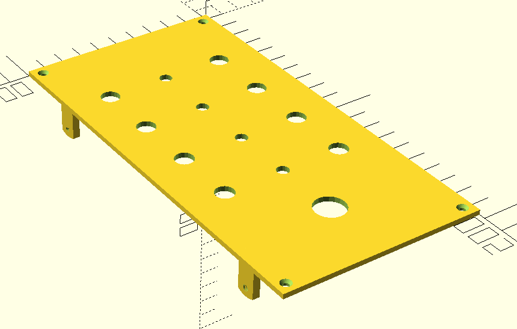
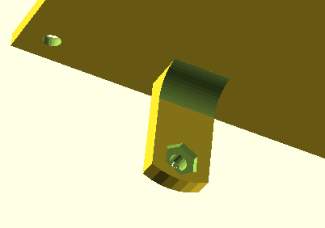

# Cynthia

Plans for my modular synthesizer, named Cynthia.


I have split the modules into folders with numbered names.
These numbers only correspond to the order that I included them into this project.
Every project should at least contain:
- a `README.md` with more information about the module
- `schematics` for the schematics, made in [KiCAD](https://www.kicad.org/)
- `stripboard` for the design of the stripboard (you don't need this if you order proper PCBs). 
  I use [DIY Layout Creator](https://diy-fever.com/software/diylc/) for this.
- `panel` (or `front_panel`) for the front panels.
  I use custom templates for [OpenSCAD](https://openscad.org/), which can be found in `lib/openscad/`:
  `kosmo.scad` for the Kosmo-format (20cm height) panels and `eurorack.scad` for the eurorack (3U, 128.5mm) panels.
  On linux, you can use the templates by copying them to:
  ```bash
  mkdir -p ~/.local/share/OpenSCAD/libraries
  cp lib/openscad/*.scad ~/.local/share/OpenSCAD/libraries/
  ```

Some modules have additional subfolders with sound samples or Arduino source code.


## Collective BOM

`tools/collective_bom.py` collects the parts of all numbered (eurorack) modules
into a single markdown BOM, so that everything can be ordered in one go.
The KOSMO modules are not included.

```bash
tools/collective_bom.py                  # all modules, markdown on stdout
tools/collective_bom.py 01 03            # only these modules
tools/collective_bom.py -o BOM.md        # write to a file
tools/collective_bom.py --refs           # add the reference designators
tools/collective_bom.py --boards 2       # quantities for two sets of boards
```

It reads the `*.net` netlists, which are exported from KiCad via
`File > Export > Netlist` (KiCad format).
Modules without a netlist are listed at the end of the document instead of
being silently dropped.
Test points and parts marked DNP or "exclude from BOM" are skipped, and
footprints of the same physical package are merged (a `cynthia:R SMD 0805` and
a `Resistor_SMD:R_0805_...` resistor end up on the same line); the merges are
documented in the generated document.

## Case, PSU, and Bus Boards

I made my own case, following the guide from [Look Mum No Computer](https://www.youtube.com/watch?v=4T6J-K8_yk4).
Bought some wood, screwed everything together, and painted everything white.

I was not confident enough to build my own PSU since:
    1. I'm really not an electrician, and I am afraid of things blowing up.
    2. I have trouble sourcing reliable 12V AC/AC transformers.
So, I decided to buy a Meanwell RT-65B, which has +12V, -12V, and +5V outputs, and is not too expensive.
Perfect! It can also be used to power USB- or arduino-based modules.

For bus boards, I soldered some shrouded 16-pin headers on pieces of stripboard and connected everything using the same 16-pin eurorack cables that I use to power the modules.
I include smoothing caps on each module rather than on the bus boards.

## Cables

I found that the cheapest option to get cables is to just make your own. 
1/4 inch jacks are cheap, and you have the benefit of making the sizes that you actually need.
I bought a 30m microphone cable from which I snip off what I need.

## OpenSCAD panels

Design the panels using [OpenSCAD](https://openscad.org/), because it is intuitive to me as a programmer.
I then print the panels using a standard filament 3D printer.
Both templates define the same basic modules (`panel`, `jack`, `pot`, `led`, `switch`, `pushButton`, ...),
so only include one of them per panel.

### Eurorack panels

`eurorack.scad` sets the panel height to 128.5mm and provides `hp(n)` for the panel width
(`n * 5.08mm - 0.3mm` tolerance, so that neighbouring panels don't jam).

The mounting holes follow the Doepfer A-100 spec: 3mm from the top and bottom edges, the first hole 7.5mm from the
left edge, and further positions on the 5.08mm (1HP) grid. `euroRackMountHoles(n_top, n_bot)` places one hole at
the top and one at the bottom, each shifted `n` HP to the right of the first position. Shifting the two holes
to different positions lets neighbouring modules share a rail without their screws colliding.
The holes are 3.2mm wide (M3 clearance) and slotted horizontally by 3mm for tolerance.
For custom positions, use `euroRackMountHole(x, y, d, slot)` directly.

The following example generates the 4HP panel of the `05_midi_to_cv` drum velocity player:

```
include <eurorack.scad>

difference() {
    panel(hp(4));

    euroRackMountHoles(0, 1); // top hole at 7.5mm, bottom hole at 12.58mm

    jack(10, 19.75);
    jack(10, 30.75);

    microswitch((11.5+16)/2, 65.5);
    led((6.5-1.27), 65.5);

    jack(10, 97.75);
    jack(10, 108.75);
}
```

### Kosmo panels

The following example generates a panel for the first module, the `01_poly_midi_2_cv`:

```
width = 100;
include <kosmo.scad>

difference(){
    panel(width);
    midiSocket(width/2, panelHeight-35);
    
    buffer=20; // space between border and first item

    jack(buffer, 40); 
    switch(width/2, 40);
    jack(width-buffer, 40);
    
    jack(buffer, 70); 
    switch(width/2, 70);
    jack(width-buffer, 70);
    
    jack(buffer, 100); 
    switch(width/2, 100);
    jack(width-buffer, 100);
    
    jack(buffer, 130); 
    switch(width/2, 130);
    jack(width-buffer, 130);
}
pcbHolders();

```

This results in the following panel: 

I have included two tabs for the PCB that are printed with the panel, to which I can screw the PCB using M3 screws.
The tabs have small indentations for the nuts.
Since I have a crappy 3D printer, those holes are not very tidy, and I use my soldering iron to convince the nuts to go where they should.
And since I am an even crappier woodcraftsman than I am an electrician, the panels are set to 197 mm height in the library file to compensate for the bad measuring I did when making the case.



> [!NOTE]
> The distance between the tabs that I have used depends on the pre-drilled holes of the strip boards that I like to use.
> Please change this distance if you have other PCBs.

## PCB Design and Build Notes

Lessons from the first batch of eurorack PCBs (#05 rev1), to keep in mind for every new board.

### Layout

- **Same orientation on sibling boards.** Boards that share most of their circuit (like the #05 players) should
  place shared parts in the same orientation. On #05 rev1, the TL072 on the drum velocity player was rotated
  180° compared to the melodic player, which cost me one botched soldering job. Across the whole project,
  keep IC pin 1 in the same corner wherever the layout allows.
- **Align bus headers between coupled modules.** When modules are connected by a ribbon cable (like the #05
  player bus), put the bus header at the same vertical position on every PCB, so the cable runs straight
  across the case.

### Releasing a board revision

- Put a silkscreen text on every board saying what it is and which revision it is, e.g.
  `#05: Conductor: Main Board` / `Rev. 2`. Set the same title and revision in the schematic's title block,
  so the netlist carries them too. Boards of a multi-board module or sibling modules look alike once they
  are out of the bag, and a rev1 board in hand must be told apart from a rev2 one.
- Commit the exact state that is sent to the fab, including the Gerbers, and tag that commit as
  `<module>-rev<N>` (e.g. `05-rev1`). Start the next revision from that tag, so the ordered version can
  always be recovered.

### Bring-up

- Measure every supply rail at the **far end** of a bus as well as at its source. On #05 rev1, a bad solder
  joint on the conductor meant that -12V never reached the players. Nothing on the conductor uses -12V, so the
  conductor tested fine, and the fault only showed up as a player op-amp stuck high.

## Thanks to

I heavily relied on all material by [Moritz Klein](https://www.youtube.com/@MoritzKlein0). 
Thanks for these awesome videos.
These were the starting point for my project.

Further good sources that I recommend are: 
 - https://www.eddybergman.com
 - https://www.lookmumnocomputer.com


P.S. I have built Cynthia using striboards, because I wanted to learn and prototype fast.
Should you design some PCBs for any of the modules, I'd love to include them in this repository.
